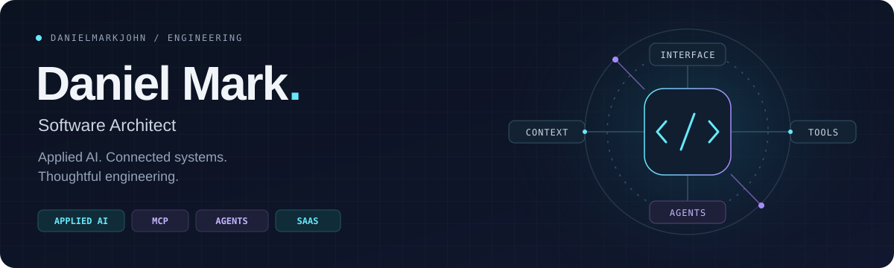

  

<h1 align="center">Software Architect · Applied AI · SaaS Platforms</h1>

  Building useful AI into software that scales. 
  <b>LLM integrations · Model Context Protocol · Agent workflows · MEAN / MERN</b>

  

  
  
  

---

## /about

I'm **Daniel Mark**, a Software Architect focused on **SaaS platforms, full-stack engineering, and AI-powered product experiences**. I work across MEAN and MERN applications, bringing together frontend architecture, backend services, cloud automation, and delivery pipelines.

My current direction: **connect LLMs to real tools, useful context, and meaningful workflows**—with the architecture to support the product around them.

## /applied-ai

**What I'm building toward and exploring right now:**

| Focus | Engineering interests |
| :--- | :--- |
| **LLM integrations** | AI features in SaaS products, conversational interfaces, streaming responses, structured outputs, and API integrations. |
| **MCP integrations** | Connecting AI applications with tools, APIs, and resources through the **Model Context Protocol**. |
| **Agents & automation** | Tool calling, workflow orchestration, context and state management, and human-in-the-loop execution. |
| **RAG · learning & prototyping** | Document ingestion, chunking, embeddings, vector search, reranking, and grounded answers for MEAN/MERN applications. |
| **AI quality · exploring** | Evaluation, tracing, prompt versioning, guardrails, and the tradeoffs between response quality, latency, and token cost. |

## /architecture

- **Frontend systems** — React, Angular, Next.js, PWAs, microfrontends, and accessible interfaces guided by WCAG.
- **Application platforms** — MEAN / MERN, GraphQL, backend services, and real-time experiences.
- **Engineering at scale** — Monorepos, CI/CD, cloud automation, application performance monitoring, and maintainable delivery practices.
- **Product thinking** — Scalable architecture, useful automation, and an entrepreneurial approach to solving problems.

## /stack

**Frontend & experience**

**Backend & APIs**

**Data & persistence**

**Cloud & delivery**

<b>Expand the wider toolkit</b>

| Area | Technologies |
| :--- | :--- |
| Additional backends | .NET · Flask · Spring |
| Databases & ORM | MySQL · Sequelize |
| AI / ML toolkit | LLMs · TensorFlow · PyTorch |
| Delivery & collaboration | Jenkins · Git · GitHub · Jira · Notion |
| Component & API tooling | Storybook · Swagger |

## /open-source

Some of the foundations behind my full-stack work:

| Repository | Focus |
| :--- | :--- |
| [**atlas-angular-frontend-boilerplate**](https://github.com/danielmarkjohn/atlas-angular-frontend-boilerplate) | Angular frontend foundations. |
| [**atlas-node-backend**](https://github.com/danielmarkjohn/atlas-node-backend) | A backend foundation for the MEAN stack. |
| [**atlas-angular-password-strength**](https://github.com/danielmarkjohn/atlas-angular-password-strength) | An Angular password-strength component. |

**[Explore all repositories →](https://github.com/danielmarkjohn?tab=repositories)**

## /github-activity

  
  

  

  

Public GitHub activity is one part of my work. Language charts describe repository composition, not proficiency.

---

  <b>Build useful systems. Make complexity understandable. Keep improving.</b>  
  Interested in applied AI, SaaS architecture, developer tooling, or a product idea? 
  <a href="https://www.linkedin.com/in/danielmarkjohn/">Let's connect on LinkedIn</a>.

Widget credits

[GitHub Readme Stats](https://github.com/anuraghazra/github-readme-stats) · [Stats Action](https://github.com/stats-organization/github-readme-stats-action) · [Streak Stats](https://github.com/DenverCoder1/github-readme-streak-stats) · [Activity Graph](https://github.com/Ashutosh00710/github-readme-activity-graph) · [Shields.io](https://shields.io)

