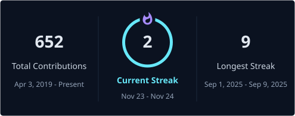

  

  <b>Software Architect · Applied AI · SaaS Platforms</b> 
  Connecting great interfaces, scalable systems, and useful intelligence.

  

<h1 align="center">Software Architect · Applied AI · SaaS Platforms</h1>

  Building useful AI into software that scales. 
  <b>LLM integrations · Model Context Protocol · Agent workflows · MEAN / MERN</b>

  

  
  
  

  Follow along for projects and experiments in applied AI, developer tooling, and full-stack architecture.

  <a href="#applied-ai">Applied AI</a> ·
  <a href="#architecture">Architecture</a> ·
  <a href="#stack">Stack</a> ·
  <a href="#open-source">Projects</a> ·
  <a href="#github-activity">Activity</a> ·
  <a href="#connect">Connect</a>

---

## /about

I connect **frontend experiences, backend systems, and cloud infrastructure** to build SaaS platforms. My foundation is **MEAN / MERN**, with a focus on scalable architecture, accessible interfaces, and dependable delivery.

I'm extending that foundation into **LLM integrations, MCP-connected tools, and agent workflows**—bringing AI into the products and processes people actually use.

**What drives me:** thoughtful engineering, cloud automation, entrepreneurship, and turning complex ideas into useful software.

## /stack

**Frontend & experience**

**Backend & APIs**

**Data & persistence**

**Cloud & delivery**

## /applied-ai

**Current focus: the application layer of AI.**

From model integrations to tools, context, and orchestration, these are the areas I'm building toward and exploring:

| Focus | Engineering interests |
| :--- | :--- |
| **LLM integrations** | AI features in SaaS products, conversational interfaces, streaming responses, structured outputs, and API integrations. |
| **MCP integrations** | **Model Context Protocol** servers and clients that connect AI applications with tools, APIs, and resources. |
| **Agents & automation** | Tool calling, workflow orchestration, context and state management, and human-in-the-loop execution. |
| **AI developer workflows** | Coding agents, reusable skills, context engineering, and reviewable automation across the development lifecycle. |
| **RAG · learning & prototyping** | Document ingestion, chunking, embeddings, vector search, reranking, and grounded answers for MEAN/MERN applications. |
| **AI quality · exploring** | Evaluation, tracing, prompt versioning, guardrails, and the tradeoffs between response quality, latency, and token cost. |

## /architecture

- **Frontend systems** — React, Angular, Next.js, PWAs, microfrontends, and accessible interfaces guided by WCAG.
- **Application platforms** — MEAN / MERN, GraphQL, backend services, and real-time experiences.
- **Engineering at scale** — Monorepos, CI/CD, cloud automation, application performance monitoring, and maintainable delivery practices.
- **Product thinking** — Scalable architecture, useful automation, and an entrepreneurial approach to solving problems.

<b>Expand the wider toolkit</b>

| Area | Technologies |
| :--- | :--- |
| Additional backends | .NET · Flask · Spring |
| Databases & ORM | MySQL · Sequelize |
| AI / ML toolkit | LLMs · TensorFlow · PyTorch |
| Delivery & collaboration | Jenkins · Git · GitHub · Jira · Notion |
| Component & API tooling | Storybook · Swagger |

## /open-source

Explore the foundations behind my full-stack work:

| Repository | Focus |
| :--- | :--- |
| [**Angular frontend starter ↗**](https://github.com/danielmarkjohn/atlas-angular-frontend-boilerplate) | Frontend foundations with Angular. |
| [**MEAN backend foundation ↗**](https://github.com/danielmarkjohn/atlas-node-backend) | Backend foundations with Node.js. |
| [**Angular password strength ↗**](https://github.com/danielmarkjohn/atlas-angular-password-strength) | A focused Angular component project. |

**[Explore all repositories →](https://github.com/danielmarkjohn?tab=repositories)**

Found something useful? Star the repository. Have an improvement in mind? Open an issue or contribute a pull request.

## /github-activity

  
  

  

  

A snapshot of public activity. Language distribution reflects repository composition.

---

## /connect

**Working on an AI-powered product, a developer tool, or an architecture challenge? Let's compare ideas.**

I'm interested in conversations around **applied AI, SaaS architecture, accessible web experiences, cloud automation, and entrepreneurship**.

| Follow the work | Start a conversation |
| :--- | :--- |
| **[Follow on GitHub →](https://github.com/danielmarkjohn)** Explore repositories, experiments, and future projects. | **[Connect on LinkedIn →](https://www.linkedin.com/in/danielmarkjohn/)** Talk architecture, AI integrations, and product ideas. |

  

<b>Build useful systems. Make complexity understandable. Keep improving.</b>

Widget credits

[GitHub Readme Stats](https://github.com/anuraghazra/github-readme-stats) · [Stats Action](https://github.com/stats-organization/github-readme-stats-action) · [Streak Stats](https://github.com/DenverCoder1/github-readme-streak-stats) · [Activity Graph](https://github.com/Ashutosh00710/github-readme-activity-graph) · [Shields.io](https://shields.io)

Widget credits

[GitHub Readme Stats](https://github.com/anuraghazra/github-readme-stats) · [Stats Action](https://github.com/stats-organization/github-readme-stats-action) · [Streak Stats](https://github.com/DenverCoder1/github-readme-streak-stats) · [Activity Graph](https://github.com/Ashutosh00710/github-readme-activity-graph) · [Shields.io](https://shields.io)

